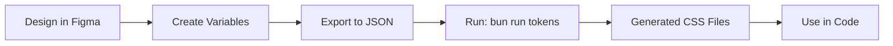
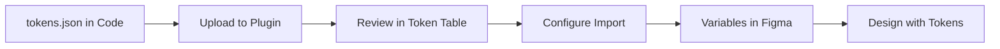

# Cipher - Feature Matrix

**Last Updated:** December 16, 2024

This document defines Cipher's core features, their current status, and priorities.

---

## 🎯 Core Feature Categories

### 1. Token Sync (Import/Export)

The bidirectional workflow between code and Figma.

#### 1.1 Import (JSON → Figma) ✅ **BUILT**

**Status:** Implemented & Working

**What it does:**
- Parse `tokens.json` and create Figma Variables
- Support multiple collections (primitives, semantics, etc.)
- Handle modes (Light/Dark, responsive breakpoints)
- Resolve token references (`{primitives.zinc.50}`)
- Track changes (created/updated/unchanged)

**User Flow:**
```
Upload JSON → Review Tokens → Select Collections → Configure → Import
```

**Key Components:**
- ✅ `FileImport` - Drag & drop JSON upload
- ✅ `TokenTable` - Preview and edit tokens before import
- ✅ `CollectionSelector` - Choose which collections to create
- ✅ `ProgressView` - Real-time import progress
- ✅ Inline editing of token names and values
- ✅ Batch operations (select all, deselect)

---

#### 1.2 Export (Figma → JSON) 🚧 **PARTIAL**

**Status:** UI exists, needs enhancement

**What it should do:**
- Select Figma Variable collections to export
- Generate `tokens.json` in W3C design tokens format
- Generate `styles.json` with Figma metadata (opacity, effects)
- Preview JSON before download
- Copy to clipboard or download files

**Needed Enhancements:**
- [ ] Generate proper W3C token format
- [ ] Include `styles.json` with opacity data
- [ ] Add format options (Simple JSON, Style Dictionary, Tailwind)
- [ ] Better preview UI with syntax highlighting
- [ ] Batch export multiple collections

**Priority:** **P0** (Critical for v1.0)

---

#### 1.3 Styles Export (Figma Styles → JSON) 🚧 **PARTIAL**

**Status:** UI exists, implementation partial

**What it should do:**
- Export Color, Text, Effect styles from Figma
- Generate JSON representation
- Include all style properties and metadata

**Current Limitation:**
- Cipher focuses on Variables (modern approach)
- Styles export is secondary priority
- Most users should migrate Styles → Variables

**Priority:** **P2** (Nice to have, not blocking)

---

### 2. Token Preview & Editor

Inspect and modify tokens before import/after parsing.

#### 2.1 Token Table View ✅ **BUILT**

**Status:** Fully implemented

**Features:**
- ✅ Display all parsed tokens in table
- ✅ Filter by category (color, spacing, etc.)
- ✅ Search/filter tokens
- ✅ Show token metadata (type, collection, value)
- ✅ Visual preview for colors
- ✅ Selection controls (select all, deselect)
- ✅ Change tracking indicators

**UI Components:**
- `TokenTable.tsx` - Main table component
- Inline editing for names and values
- Action dropdowns (import, skip, update)

---

#### 2.2 Inline Editing ✅ **BUILT**

**Status:** Fully implemented

**Features:**
- ✅ Edit token names (click to edit)
- ✅ Edit token values inline
- ✅ Type-aware validation (colors, numbers, strings)
- ✅ Real-time preview updates
- ✅ Undo/cancel changes

---

#### 2.3 Batch Edit Operations ✅ **BUILT**

**Status:** Implemented with BatchRenameDialog

**Current Features:**
- ✅ Find & replace in token names
- ✅ Scope selection (all, name only, path only)
- ✅ Regex support
- ✅ Preview changes before applying
- ✅ Bulk action selection (import/skip all)

**Potential Enhancements:**
- [ ] Prefix/suffix addition
- [ ] Value transformation (multiply all spacing by 1.5)
- [ ] Category reassignment
- [ ] Duplicate detection and merging
- [ ] Bulk delete

**Priority:** **P1** (Important for workflow efficiency)

---

### 3. Generate Styles (CSS/Code Generation)

Convert tokens to usable code formats.

#### 3.1 CSS Variable Generation ✅ **BUILT**

**Status:** Fully implemented via `scripts/generate-tokens.ts`

**What it does:**
- Read `tokens.json` + `styles.json`
- Generate CSS files with:
  - CSS custom properties (--color-*, --spacing-*, etc.)
  - Proper prefixes based on token type
  - @theme inline blocks for Tailwind compatibility
  - color-mix() for opacity handling
  - Light/Dark mode selectors

**Output:**
```css
/* primitives.css */
:root {
  --color-zinc-50: #fafafa;
  --spacing-4: 16px;
  --radius-md: 6px;
}

/* semantics.css */
:root {
  --background-primary: var(--color-zinc-200);
  --background-secondary: color-mix(in srgb, var(--color-zinc-50), transparent 20%);
}

.dark {
  --background-primary: var(--color-zinc-800);
}

@theme inline {
  --color-background-primary: var(--background-primary);
}
```

**Features:**
- ✅ Dynamic opacity detection (auto-finds 100+ tokens with opacity)
- ✅ Future-proof (zero hardcoding, adapts to new tokens)
- ✅ Fast (<1s for 500+ tokens)
- ✅ Separate files per collection

**Usage:**
```bash
bun run tokens        # Generate CSS
bun run tokens:watch  # Watch mode
```

---

#### 3.2 CSS Preview in Plugin 🔮 **FUTURE**

**Status:** Not implemented

**What it could do:**
- Preview generated CSS directly in plugin UI
- Copy CSS to clipboard
- Download CSS files
- Toggle between formats (CSS vars, Tailwind, SCSS)

**Priority:** **P1** (High value for developer handoff)

**Acceptance Criteria:**
- [ ] After export, show "View Generated CSS" button
- [ ] Syntax-highlighted preview
- [ ] Format selector (CSS, Tailwind, SCSS, Style Dictionary)
- [ ] Copy and download buttons
- [ ] Preview multiple collections

---

#### 3.3 Multiple Format Support 🔮 **FUTURE**

**Status:** Not implemented (only CSS vars currently)

**Potential Formats:**
- [ ] **CSS Variables** (current) ✅
- [ ] **Tailwind Config** (tailwind.config.js)
- [ ] **SCSS Variables** ($color-primary: #000)
- [ ] **Style Dictionary** (W3C format)
- [ ] **JavaScript/TypeScript** (export const colors = {})
- [ ] **iOS/Android** (Swift/Kotlin)

**Priority:** **P2** (Nice to have, CSS vars sufficient for v1.0)

---

## 📊 Feature Status Summary

| Feature Category | Status | Priority | Notes |
|-----------------|--------|----------|-------|
| **Token Sync** |
| Import (JSON → Figma) | ✅ Built | P0 | Fully working |
| Export (Figma → JSON) | 🚧 Partial | P0 | Needs enhancement |
| Styles Export | 🚧 Partial | P2 | Secondary to Variables |
| **Token Editor** |
| Token Table View | ✅ Built | P0 | Fully working |
| Inline Editing | ✅ Built | P0 | Fully working |
| Batch Operations | ✅ Built | P0 | Batch rename working |
| Advanced Batch Edit | 🔮 Future | P1 | Value transforms, etc. |
| **Generate Styles** |
| CSS Generation (CLI) | ✅ Built | P0 | Via scripts |
| CSS Preview (in-plugin) | 🔮 Future | P1 | High value |
| Multiple Formats | 🔮 Future | P2 | Nice to have |

**Legend:**
- ✅ Built - Fully implemented and working
- 🚧 Partial - UI exists but needs work
- 🔮 Future - Planned but not started
- P0 = Critical, P1 = Important, P2 = Nice to have

---

## 🎯 Recommended Priority Order

### Phase 2 (Current - Q1 2025)

**Focus: Export & Sync Completion**

1. **Export Enhancement** (P0)
   - Generate proper W3C token JSON format
   - Include styles.json with opacity data
   - Add download functionality
   - Improve export UI/UX

2. **CSS Preview in Plugin** (P1)
   - Show generated CSS after export
   - Copy to clipboard functionality
   - Basic format selector

3. **Bidirectional Sync Testing** (P0)
   - Ensure round-trip integrity
   - Test import → edit → export → import
   - Document workflow

### Phase 3 (Q2 2025)

**Focus: Polish & Advanced Features**

4. **Advanced Batch Edit** (P1)
   - Value transformations
   - Bulk operations beyond rename
   - Better filtering and search

5. **Multiple Format Support** (P2)
   - Tailwind config generation
   - Style Dictionary format
   - SCSS variables

6. **Token Validation** (P1)
   - Check for broken references
   - Circular dependency detection
   - Accessibility contrast checking

---

## 💡 Feature Ideas (Backlog)

Ideas to consider for future versions:

### Token Management
- [ ] Token diff view (compare before/after)
- [ ] Token history/versioning
- [ ] Duplicate detection and merging
- [ ] Token relationships visualization

### Generation
- [ ] Custom templates for CSS generation
- [ ] Plugin hooks for custom transformations
- [ ] Theme variants generator (create 5 color schemes)

### Collaboration
- [ ] Export configuration presets
- [ ] Team sharing (save/load configs)
- [ ] Comments on tokens

### Developer Experience
- [ ] CLI tool for headless generation
- [ ] VS Code extension integration
- [ ] Git hooks for auto-generation
- [ ] Watch mode for live preview

---

## 🔄 The Complete Workflow

### Design → Code (Current)



**Status:** 
- A → B: Manual
- B → C: 🚧 Needs work (Export)
- C → D: ✅ Works perfectly
- D → E: ✅ Automatic
- E → F: ✅ Copy-paste or import

### Code → Design (Current)



**Status:** 
- A → B: ✅ Works
- B → C: ✅ Works
- C → D: ✅ Works
- D → E: ✅ Works
- E → F: ✅ Works

---

## 📋 Next Steps

### Immediate (This Week)
1. Review this feature matrix
2. Confirm priority order
3. Plan Export enhancement sprint
4. Write export specification

### Short Term (Next 2 Weeks)
1. Implement enhanced export
2. Add CSS preview in plugin
3. Test bidirectional workflow
4. Document complete workflow

### Medium Term (Next Month)
1. Advanced batch operations
2. Token validation
3. Multiple format support
4. Polish and bug fixes

---

## ❓ Questions to Answer

1. **Export Format Priority?**
   - Start with simple JSON or W3C format?
   - Decision: Simple JSON first, matches current import

2. **CSS Preview Scope?**
   - Just show CSS or make it editable?
   - Decision: Read-only preview first, editing later

3. **Batch Edit Complexity?**
   - How advanced should value transforms be?
   - Decision: Start with common operations (multiply, add prefix)

4. **CLI Tool Timing?**
   - Build now or wait for user demand?
   - Decision: Wait until v1.0.0 feedback

---

**Status:** Living Document  
**Next Review:** Weekly during development  
**Owner:** You Zhang (ATOM63)

