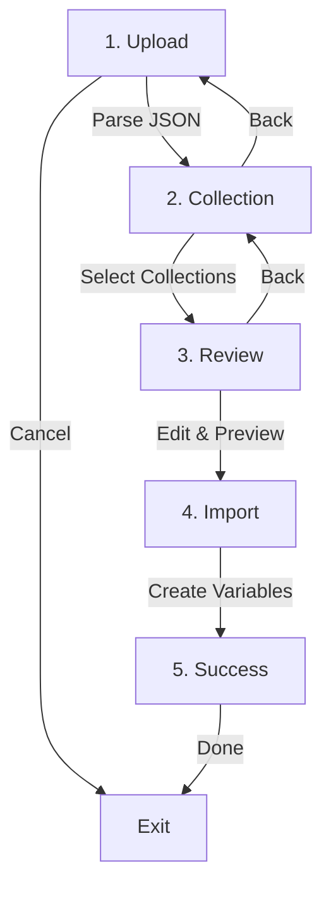

# Import Flow - Token Preview & Review

**Current Status:** ✅ Fully Implemented  
**Location:** `pages/ImportPage.tsx`

---

## 📋 Current Import Flow (5 Steps)



### Step 1: Upload (`view='upload'`) ✅

**What happens:**
- User drags & drops or selects JSON file
- Plugin sends file to code thread for parsing
- `parseJSON()` validates and structures the data

**UI Elements:**
- `FileImport` component
- Drag & drop zone
- File picker button
- Format instructions

**User Actions:**
- Upload `tokens.json`
- Upload `styles.json`
- Cancel

---

### Step 2: Collection Selection (`view='collection'`) ✅

**What happens:**
- Display all collections found in JSON
- Show token count per collection
- User selects which collections to import
- Configure import mode (new vs append)

**UI Elements:**
- `CollectionSelector` component
- Checkboxes for each collection
- Import mode selector (import/override)
- Token count summary

**User Actions:**
- Select/deselect collections
- Choose import mode
- Set collection name
- Back to upload
- Continue to review

**Example:**
```
☑ primitives (475 tokens)
☑ abstractions (192 tokens)  
☑ semantics (112 tokens)
☐ responsive (23 tokens)

Import mode: ● New Collection  ○ Append to Existing
Collection name: [Design Tokens]

[← Back] [Review Tokens →]
```

---

### Step 3: Review (`view='review'`) ✅ **THE KEY STEP**

**What happens:**
- Display ALL tokens in an editable table
- User can preview, edit, and filter tokens
- Changes are tracked in real-time
- No Figma variables created yet

**UI Elements:**
- `TokenTable` component (main preview)
- Filter dropdown (all, colors, spacing, etc.)
- Search input
- Select all checkbox
- Inline editors for names and values
- Action dropdowns (import, skip, update)
- Batch rename dialog

**User Actions:**
- **Preview:** See all token names, types, values
- **Edit:** Click any name/value to edit inline
- **Filter:** Show only specific token types
- **Search:** Find tokens by name
- **Select:** Choose which tokens to import
- **Batch Edit:** Rename multiple tokens at once
- **Back:** Return to collection selection
- **Import:** Proceed to create Figma variables

**Token Table Features:**

```
┌─────────────────────────────────────────────────────────────┐
│ Filter: [All Types ▼]  Search: [____________]  [Batch Edit] │
├─────────────────────────────────────────────────────────────┤
│ [☑] Select All                                               │
├────┬──────────────────────┬──────┬───────────┬──────────────┤
│ ☑  │ Name                 │ Type │ Value     │ Action       │
├────┼──────────────────────┼──────┼───────────┼──────────────┤
│ ☑  │ primitives/zinc/50   │ color│ ███ #fafa │ Import ▼     │
│ ☑  │ primitives/zinc/100  │ color│ ███ #f4f4 │ Import ▼     │
│ ☑  │ primitives/spacing/4 │ space│ 16px      │ Import ▼     │
│ ☐  │ primitives/radius/md │ radius│ 6px      │ Skip ▼       │
└────┴──────────────────────┴──────┴───────────┴──────────────┘

                  [← Back] [Import 473 Tokens →]
```

**Inline Editing:**
- Click any token name → Edit → Press Enter or click away to save
- Click any value → Edit (with type validation) → Save
- Changes are instant and reflected in preview

**Batch Operations:**
- **Batch Rename:** Find & replace in token names
  ```
  Find: "primitives/color"
  Replace: "primitives/colors"
  Scope: [●] All  [ ] Name only  [ ] Path only
  [x] Use regex
  
  23 tokens will be affected
  [Preview] [Apply]
  ```

**Why This Step is Crucial:**
1. ✅ **Safety:** User sees exactly what will be created
2. ✅ **Control:** Can edit names and values before import
3. ✅ **Flexibility:** Can skip unwanted tokens
4. ✅ **Confidence:** No surprises, full transparency

---

### Step 4: Import (`view='progress'`) ✅

**What happens:**
- User confirms import
- Plugin sends selected tokens to Figma API
- `createVariablesFromTokens()` creates actual Figma variables
- Progress shown in real-time

**UI Elements:**
- `ProgressView` component
- Progress bar
- Status messages
- Token counter (X of Y created)

**User Actions:**
- Wait for completion
- View progress
- (Cannot cancel once started)

**Example:**
```
Creating Variables...

████████████░░░░░░░░░░  60% (285 / 475)

Creating primitives/zinc/600...

⏱ Estimated time: 12 seconds
```

---

### Step 5: Success (`view='success'`) ✅

**What happens:**
- Show import results
- Display change summary (created/updated/unchanged)
- Option to view in Figma or import more

**UI Elements:**
- Success message
- Statistics card
- Change tracking list
- Action buttons

**User Actions:**
- Review what was created
- Start new import
- Close plugin

**Example:**
```
✅ Import Complete!

📊 Summary:
   • 473 variables created
   • 2 variables updated
   • 0 errors

Changes:
   ✓ Created: primitives/zinc/50 → #fafafa
   ✓ Created: primitives/zinc/100 → #f4f4f4
   ↻ Updated: semantics/background → #e4e4e7
   ... (show all)

[Import More] [Close]
```

---

## 🎯 Current Implementation Status

| Step | Status | Component | Quality |
|------|--------|-----------|---------|
| 1. Upload | ✅ Built | `FileImport` | Excellent |
| 2. Collection | ✅ Built | `CollectionSelector` | Good |
| 3. Review | ✅ Built | `TokenTable` | Excellent |
| 4. Import | ✅ Built | `ProgressView` | Good |
| 5. Success | ✅ Built | Success view | Good |

**Overall:** Flow is complete and working well!

---

## 🔍 Key Features of Review Step

### Already Implemented ✅

1. **Table View**
   - ✅ Display all tokens in organized table
   - ✅ Visual preview for colors
   - ✅ Type indicators
   - ✅ Collection grouping

2. **Filtering & Search**
   - ✅ Filter by type (color, spacing, etc.)
   - ✅ Search by name
   - ✅ Select all / deselect all

3. **Inline Editing**
   - ✅ Edit token names
   - ✅ Edit token values
   - ✅ Type validation
   - ✅ Real-time preview

4. **Batch Operations**
   - ✅ Batch rename with find & replace
   - ✅ Regex support
   - ✅ Preview before applying

5. **Action Control**
   - ✅ Import / Skip / Update per token
   - ✅ Selection state management
   - ✅ Change tracking

---

## 💡 Potential Enhancements

### 1. Visual Improvements (P1)

**Better Color Preview:**
```typescript
// Current: Small color swatch
// Enhanced: Larger swatch with hex value on hover

<div className={styles.colorPreview}>
  <div 
    className={styles.colorSwatch} 
    style={{ backgroundColor: token.value }}
    title={`${token.value} (Click to copy)`}
  />
  <span className={styles.colorValue}>{token.value}</span>
</div>
```

**Group by Collection:**
```
▼ primitives (475 tokens)
  ▼ color (360 tokens)
    • zinc/50 #fafafa
    • zinc/100 #f4f4f4
  ▼ spacing (96 tokens)
  ▼ radius (19 tokens)

▼ semantics (112 tokens)
  ▼ background (24 tokens)
  ▼ foreground (18 tokens)
```

---

### 2. Diff View (P1)

**For Override Mode:**
```
Show what will change:

Updated Tokens (3):
━━━━━━━━━━━━━━━━━━━━━━━━━━━━━━━━
semantic/background
  Old: #ffffff
  New: #fafafa
━━━━━━━━━━━━━━━━━━━━━━━━━━━━━━━━

New Tokens (5):
  + semantic/foreground
  + semantic/border
  ...

Unchanged (104)
```

---

### 3. Smart Defaults (P2)

**Auto-select Based on Context:**
```typescript
// If importing to existing collection, auto-match tokens
// If new collection, select all by default
// Remember user preferences

const smartDefaults = {
  autoSelectNew: true,
  skipUnchanged: false,
  defaultAction: 'import'
}
```

---

### 4. Token Validation (P1)

**Before Import:**
```
⚠ Validation Warnings:

• semantic/background references missing token:
  {primitives.zinc.50} not found in current file

• 3 circular references detected:
  - color-a → color-b → color-a

• 5 contrast warnings:
  - foreground on background: 2.1:1 (needs 4.5:1)

[Fix Issues] [Import Anyway]
```

---

### 5. Advanced Filters (P2)

```
Filter by:
  Type: [Colors ▼] [Spacing] [Typography] [All]
  Collection: [primitives] [semantics] [All]
  Status: [New] [Updated] [Unchanged] [All]
  Has Issues: [ ] Show only tokens with warnings
  
Search:
  [____________________] [🔍]
  ☑ Case sensitive
  ☑ Use regex
```

---

### 6. Bulk Actions (P2)

**Additional Operations:**
```
Selected (45 tokens):

[ Transform Values ▼ ]
  • Multiply by factor (spacing × 1.5)
  • Add prefix (theme-)
  • Add suffix (-v2)
  • Change collection
  • Update all to skip
  • Update all to import
```

---

## 🎨 UI/UX Best Practices

### Current Strengths ✅

1. **Clear Progression:** User always knows current step
2. **Reversible:** Can go back to previous steps
3. **Safe:** Nothing happens until confirm
4. **Transparent:** Show exactly what will be created
5. **Editable:** Can modify before import

### Suggested Improvements

1. **Progress Indicators:**
   ```
   [1. Upload] → [2. Collections] → [3. Review] → [4. Import] → [5. Done]
      ✓              ✓              ◉ Current        ◯            ◯
   ```

2. **Quick Stats:**
   ```
   📊 Review 473 Tokens
   ═══════════════════════════════
   ☑ 360 Colors
   ☑ 96 Spacing values
   ☑ 17 Other tokens
   ═══════════════════════════════
   ```

3. **Keyboard Shortcuts:**
   ```
   Space:  Toggle selection
   Enter:  Edit selected
   Esc:    Cancel edit
   Ctrl+A: Select all
   Ctrl+F: Focus search
   Ctrl+S: Save & continue
   ```

---

## 🔄 Comparison: Before vs After Import

**Why Preview is Essential:**

| Without Preview | With Preview (Current) |
|----------------|----------------------|
| ❌ Blind import | ✅ See all tokens first |
| ❌ Can't edit before | ✅ Edit names & values |
| ❌ All or nothing | ✅ Select which to import |
| ❌ Discover errors after | ✅ Catch errors before |
| ❌ Can't skip unwanted | ✅ Skip specific tokens |
| ❌ No control | ✅ Full control |

**Your current implementation has this RIGHT!** ✅

---

## 📊 User Flow Diagram (Detailed)

```
┌─────────────────┐
│  1. Upload JSON │
│   (FileImport)  │
└────────┬────────┘
         │ Parse & validate
         ↓
┌─────────────────────────┐
│  2. Select Collections  │
│  (CollectionSelector)   │
│                         │
│ ☑ primitives (475)     │
│ ☑ semantics (112)      │
│                         │
│ Mode: New / Append     │
└────────┬────────────────┘
         │ User chooses
         ↓
┌────────────────────────────────────────┐
│  3. REVIEW TOKENS (TokenTable)         │ ← THE KEY STEP
│  ═════════════════════════════════════ │
│  Filter: [All ▼]  Search: [______]    │
│  ─────────────────────────────────────│
│  [☑] Select All                       │
│  ─────────────────────────────────────│
│  ☑ primitives/zinc/50    color  #fafa │ ← Can edit inline
│  ☑ primitives/zinc/100   color  #f4f4 │ ← Can skip
│  ☐ semantic/background   color  ref   │ ← Can change action
│  ...                                   │
│  ─────────────────────────────────────│
│  [Batch Rename] [← Back] [Import →]   │
└────────┬───────────────────────────────┘
         │ User confirms
         ↓
┌─────────────────────────┐
│  4. Creating Variables  │
│   (ProgressView)        │
│                         │
│  ████████░░░░░  60%    │
│  285 / 475 created     │
└────────┬────────────────┘
         │ Complete
         ↓
┌─────────────────────────┐
│  5. Success Summary     │
│                         │
│  ✅ 473 created        │
│  ↻ 2 updated           │
│  📊 Change log         │
└─────────────────────────┘
```

---

## ✅ Summary

**Your Import Flow is EXCELLENT!** It already has:

1. ✅ **Load tokens first** (Step 1: Upload & Parse)
2. ✅ **Preview in table** (Step 3: Review with TokenTable)
3. ✅ **Edit before import** (Inline editing)
4. ✅ **Confirm** (Explicit Import button)
5. ✅ **Add to Figma** (Step 4: Create variables)

**The review step is the heart of the UX** - users have full control and visibility before anything is created in Figma.

**Suggested Next Steps:**
1. Document this flow clearly in UI (progress steps)
2. Add token validation warnings
3. Improve visual design (grouping, better colors)
4. Add more batch operations

**But the core flow? It's already great!** 🎉

---

**Status:** Documented existing implementation  
**Next Review:** After any UX enhancements  
**Quality:** ⭐⭐⭐⭐⭐ (5/5)

